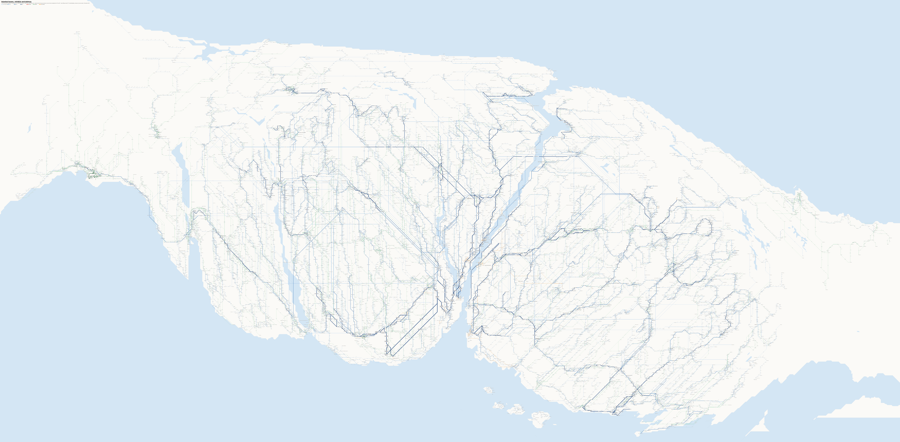
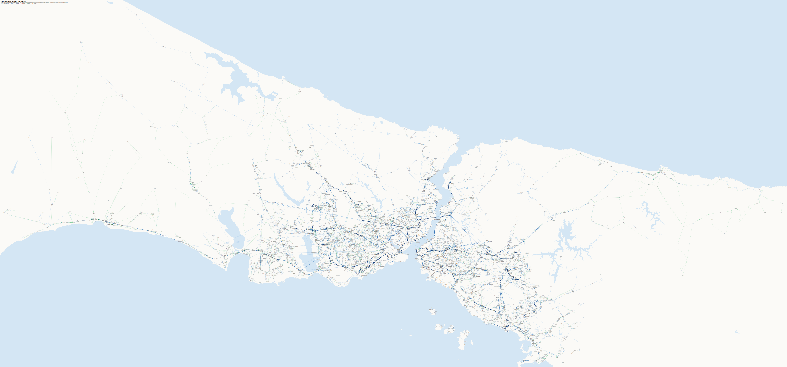

# Istanbul route map

A map of Istanbul's road public transport, drawn like a city bus map: every İETT bus line (Metrobüs included), every
minibüs line and every taksi-dolmuş line, with every stop named. It's at true scale, over the real coastline, the
Bosphorus and the lakes. The lines are straightened to 0°, 45° and 90° along their real roads.



- **The map:** [`out/istanbul-route-map.svg`](out/istanbul-route-map.svg) (33,555 × 15,670 px, about 207 px per km). Open it in a browser and zoom in.
- **Full-resolution PNG tiles,** 4 columns × 3 rows: [`out/tiles/`](out/tiles/) (`tile-r1-c1.png` is the top left).
- **The overview above,** at a quarter of the size: [`out/istanbul-route-map-overview.png`](out/istanbul-route-map-overview.png).

### Online viewer

**<https://ardyln.github.io/istanbul-route-map/>**: the whole map in the browser, with pan, zoom and stop search. Click a stop to see its lines. Two sliders redraw the map in a fraction of a second:
- **Squishing:** 0 is true scale. Higher values stretch the land where the stops are dense, along the flow of a diffusion cartogram worked out beforehand, so busy districts get room.
- **Snappiness:** 0 draws lines from stop to stop. Higher values smooth them more and straighten them to 0°, 45° and 90° on a coarser grid.

Toggles switch to straightened shores and hide the minibüs or dolmuş lines. **Merge stops** sets how stops become places: by the same name nearby (the default, as on the printed maps), only both sides of the road, or not at all (every stop sign on its own). The settings are kept in the address, so a view can be shared.

The viewer runs the same rules as `schematic.py` (`docs/layout.js`, in a background thread): every stop and line named, and no overlapping text, measured with the browser's own fonts. `make viewer` rebuilds its data (`docs/network.json`, and `docs/network-code.json` and `network-none.json` for the other ways of merging stops, fetched only when chosen).

### Geographic version

The same lines, stops and names with nothing straightened, as a fallback:
- **Exact positions:** every stop where it really is (180 px per km).
- **Lines:** drawn from stop to stop in the order they run.
- **Names:** every stop and line named, with no overlapping text. The centre is dense, so 2,046 names sit on leader lines.



- **The map:** [`out/geographic/istanbul-route-map-geographic.svg`](out/geographic/istanbul-route-map-geographic.svg) (29,178 × 13,619 px).
- **Tiles:** [`out/geographic/tiles/`](out/geographic/tiles/), 4 × 3.
- **Building:** `make map` builds both maps; `MODE=geographic SCALE=18 python3 schematic.py out.svg` builds this one alone.

## What's on it

| | |
|---|---|
| İETT bus lines (Metrobüs included) | 772 of 782 (the other 10 are depot runs, the spare-fleet code, the Büyükada taxi and the Tünel funicular) |
| Minibüs lines | 156 |
| Taksi-dolmuş lines | 18 |
| Stops | 10,592 places, every one named |
| Data | 9 November 2026 |

How to read it:
- **Lines:** İETT buses are blue (the more lines share a stretch, the thicker and darker it is), the Metrobüs red, minibüs green, and taksi-dolmuş dashed orange.
  - Route numbers are printed in tags along the lines, and every line is named at least once.
- **Geography:** the map is at true scale, and the land, sea and lakes are OpenStreetMap's, unchanged.
  - Between two interchanges, each line follows its real path, the order of its stops. Wiggles under about 150 m are smoothed away, and longer stretches are cut into pieces of at most about 600 m. Each piece is drawn at 0°, 45° and 90°, bending on the side of the real road.
  - Interchanges, terminals and branch points are snapped to a 100 m grid, so lines meet cleanly. Stops sit on their line at the point nearest where they really are: off by a median of 39 m, 95 % within 144 m.
- **Places:** both sides of a road count as one place, as do same-name stops within 300 m (never across the Metrobüs).
  - Minibüs and dolmuş stops join an İETT stop of the same name within 150 m.
  - The online viewer's **Merge stops** setting, or `MERGE=code` / `MERGE=none`, turns the same-name rule off; with `none`, both sides of a road are separate too. A minibüs or dolmuş stop that is an İETT stop (same name, within 20 m) always stays that stop.
  - Interchanges, terminals and branch points are circles; other stops are small dots.
- **Names:** names along level lines are set at 45°. Where a name has no room beside its stop, it moves further out with a thin leader line (1,150 of them).
  - **No text overlaps:** no name or route tag touches another one or a stop dot.
  - Text is sized with each character's real width (the widest of the common sans-serif fonts) and its real height above and below the line, accents on capitals included.
  - If anything had no room, the whole map would be drawn larger until it did; this map grew from 180 to 207 px per km for that.
  - `make check` measures every name and tag as Chrome draws it, on both maps: 0 overlaps.

An earlier, stretched version (a diffusion cartogram giving dense districts more room) is still in the code (`MODE=schematic`, `elastic.py`), but it distorted the city too much, so it's no longer drawn.

## How it's made

```
make data     # download everything (see Data below); stop orders take about 15 min at one request a second
make map      # compile the minibüs/dolmuş routes and draw both maps (a few seconds)
make images   # the overview PNG and the tiles (needs: cd tools && npm install, and Google Chrome)
make check    # every name and route tag measured as Chrome draws it; reports any overlap
```

- `fetch_orders.py`: each İETT line's stop order, one request a second. It can be resumed: lines already fetched are skipped.
- `dolmus_compile.py`: İBB's minibüs data doesn't link stops to lines.
  - Minibüs: a line's stops are the minibüs stops within 30 m of its route, in order along it.
  - Taksi-dolmuş: these stop anywhere, so their stands (within 80 m) and the İETT stops along the route stand in as named places to get on and off. Alternative and depot routes and depot stands are left out, and so are route pieces under 300 m (connectors between branches). A route end with no stop of its own takes the name of the nearest stop within 400 m, or "Güzergah ucu" (route end).
  - The same compiled `data/dolmus.json` feeds the dolmuş legs of the Istanbul Commute integration.
- `schematic.py`: builds the network, keeps the places where something changes, and snaps them to a grid.
  - It splits corridors that are too short for their stops, and draws every corridor with one 45° bend.
  - It places every name with a rotated-box overlap test against the names, tags and stop dots already placed, then the route tags. Every line gets at least one tag.
  - The same data always gives the same map. Settings come from the environment: `MODE` (`snapped`, the default; `geographic`; `schematic`), `SCALE` (px per 100 m to start from; `make map` uses 18, and it grows if a name has no room), `SNAP_EPS` (road wiggle smoothed away, in 100 m units, 1.5) and `SNAP_PIECE` (longest straightened piece, 6) and `MERGE` (`name`, the default: same-name stops merged as described under Places; `code`: only both sides of the road; `none`: every stop sign its own place). The `schematic` mode has its own (`WARP`, `BASE`, `ELASTIC_STEPS`, `GAP`, `MIN_GAP`, `COAST_EPS`, `COAST_PIECE`); its cartogram is cached in `data/cartogram-*.pickle`.
- `tools/measure_chars.js` measures each character's width in the installed fonts, into `tools/charwidths.json`. `tools/check_overlaps.js` is the independent check behind `make check`.

## Data

| File | Source |
|---|---|
| `data/hat.json` | Every İETT line: İBB `HatDurakGuzergah.asmx` `GetHat_json` |
| `data/durak.json` | Every İETT stop with coordinates: same service, `GetDurak_json` |
| `data/lines/*.json` | Each line's stops in order, per direction: iett.istanbul `GetStationForRoute` |
| `data/dolmus/*.geojson` | Minibüs and taksi-dolmuş routes and stops: İBB open data portal, data.ibb.gov.tr (*Minibüs Hatları/Durakları*, *Taksi Dolmuş Hatları/Durakları*, updated 4 November 2026) |
| `data/dolmus.json`, `data/dolmus_shapes.json` | Compiled from the above by `dolmus_compile.py` |
| `data/geo/coastline.json`, `data/geo/water.json` | Coastline, and lakes, reservoirs and lagoons: OpenStreetMap, via the Overpass API. `geo.py` joins the coastline into land shapes |

The data is İBB's and İETT's, published under the İBB Open Data License (İBB Açık Veri Lisansı), which asks for
attribution: *Source: İstanbul Büyükşehir Belediyesi Açık Veri Portalı / İETT*. The land and water are © OpenStreetMap contributors, available under the Open Database License (ODbL).

## License

The code is GPL-3.0 (see `LICENSE`). The data keeps its own license, above.
